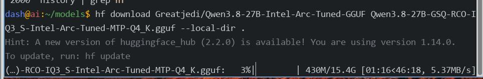
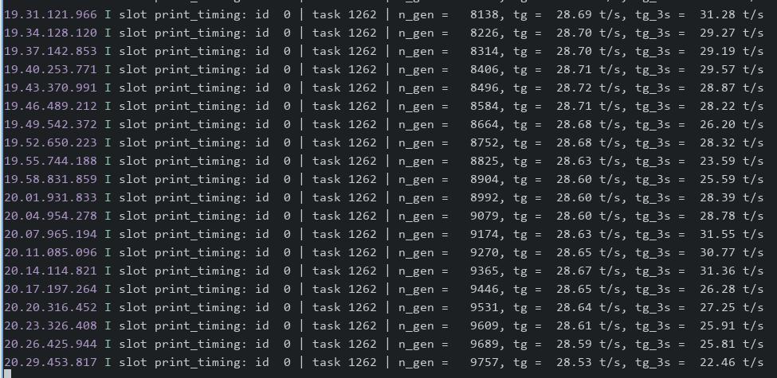

# 20261012
### 1. Intel arc(Greatjedi)
Download hf model via:      

```
export HF_ENDPOINT=https://hf-mirror.com
dash@ai:~/models$ hf download Greatjedi/Qwen3.8-27B-Intel-Arc-Tuned-GGUF Qwen3.8-27B-GSQ-RCO-IQ3_S-Intel-Arc-Tuned-MTP-Q4_K.gguf --local-dir .
hf download  unsloth/Qwen3.8-27B-GGUF mmproj-BF16.gguf --local-dir .
```



llama.cpp building:    

```
unzip llama.cpp-master.zip
mv llama.cpp-master llama.cpp-20260912
cd llama.cpp-20260912
rm -rf build
source /opt/intel/oneapi/setvars.sh --force
cmake -B build   -DGGML_SYCL=ON   -DCMAKE_C_COMPILER=icx   -DCMAKE_CXX_COMPILER=icpx   -DGGML_SYCL_F16=ON   -DLLAMA_BUILD_UI=ON   -DLLAMA_USE_PREBUILT_UI=ON   -DCMAKE_BUILD_TYPE=Release
cmake --build build --config Release -j$(nproc)
### manually download the jinja file
$ ls chat_templates/qwen-sharp.jinja 
chat_templates/qwen-sharp.jinja
```
Start the model via:    

```
$ cat start.sh
#!/bin/bash
# Sourcing oneAPI
source /opt/intel/oneapi/setvars.sh --force

# CRITICAL FOR BATTLEMAGE: Force Level Zero V1 UR adapter (prevents error 44)
export UR_LOADER_USE_LEVEL_ZERO_V2=0
export ONEAPI_DEVICE_SELECTOR=level_zero:0
export ZE_AFFINITY_MASK=0
export ZES_ENABLE_SYSMAN=1

# Start
./build/bin/llama-server -m /home/dash/models/Qwen3.8-27B-GSQ-RCO-IQ3_S-Intel-Arc-Tuned-MTP-Q4_K.gguf --mmproj  /home/dash/models/mmproj-BF16.gguf --spec-type ngram-mod,draft-mtp --spec-ngram-mod-n-match 24   --spec-ngram-mod-n-min 1   --spec-ngram-mod-n-max 3   --spec-draft-n-max 3   --spec-draft-p-min 0.5   -c 200000   --cache-type-k q4_0 --cache-type-v q4_0   -ngl 99 -ngld 99 -fa on   -ub 1024 -b 1024 -t 4 -tb 6 --parallel 1   --jinja --chat-template-file  chat_templates/qwen-sharp.jinja --reasoning-preserve   --host 0.0.0.0 --port 8183
```
The token generation speed is around `30 tps`:    




