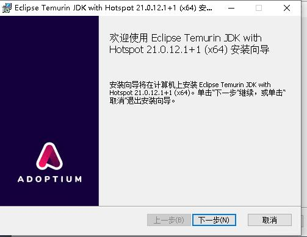
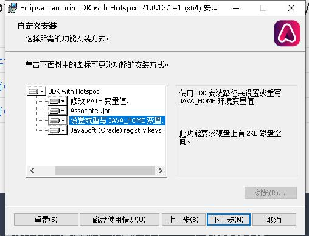
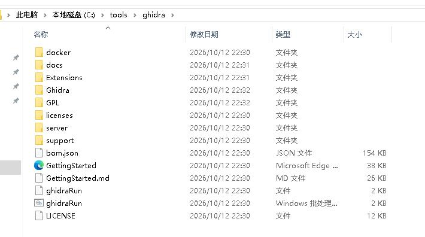
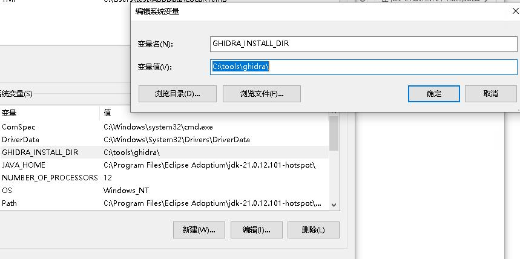
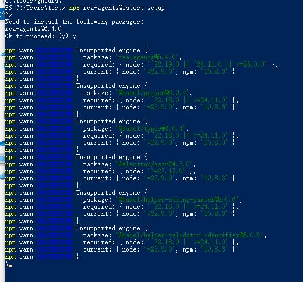
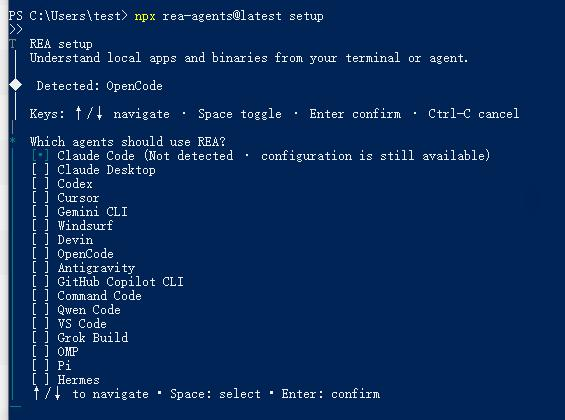
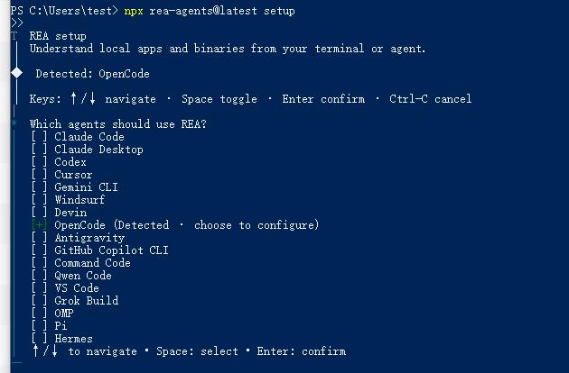
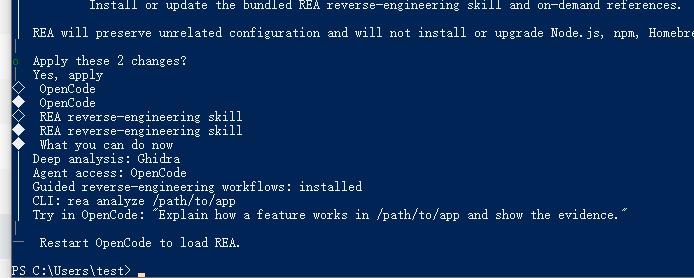
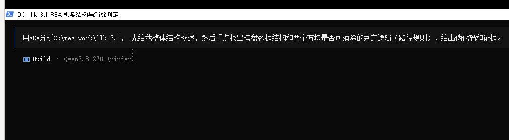
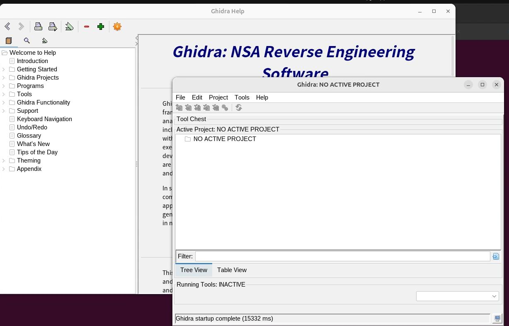

# 20261013
### 1. Activate Windows
Via:      

```
irm https://get.activated.win | iex
Then press 1
```
### 2. REA Worktips
Install nodejs and python:    

```
1. 安装 Node.js（最优先）
直接下载 64 位 MSI 安装包（推荐 LTS 22 或 24）：

清华镜像（推荐）：
https://mirrors.tuna.tsinghua.edu.cn/nodejs-release/

进入后找最新的 v22.x.x 或 v24.x.x 文件夹，下载里面的
node-v22.xx.x-x64.msi（或对应版本）。

备用阿里云：
https://mirrors.aliyun.com/nodejs-release/

安装时一路下一步，勾选 “Add to PATH”。

装完后重新打开 PowerShell，验证：

node -v
npm -v
然后立刻换国内 npm 源（加速后续下载）：

npm config set registry https://registry.npmmirror.com
2. 安装 Python 3.12
清华镜像：
https://mirrors.tuna.tsinghua.edu.cn/python/

进入 3.12.x 最新小版本文件夹，下载 python-3.12.x-amd64.exe

备用：https://registry.npmmirror.com/binary.html?path=python/

安装时必须勾选 “Add python.exe to PATH”。

验证：

python --version
```
jdk21(ghidra需要):    

```
 https://mirrors.tuna.tsinghua.edu.cn/Adoptium/
下载地址:   
https://mirrors.tuna.tsinghua.edu.cn/Adoptium/21/jdk/x64/windows/OpenJDK21U-jdk_x64_windows_hotspot_21.0.12.1_1.zip
```



全选所有功能:    



下载:     

```
https://github.com/NationalSecurityAgency/ghidra/releases/download/Ghidra_12.1.4_build/ghidra_12.1.4_PUBLIC_20260921.zip
```

解压到 C:\tools\ghidra。



允许powershell下执行:    

```
Set-ExecutionPolicy -Scope CurrentUser -ExecutionPolicy RemoteSigned
```

Opencode:    

```
在当前机器的 PowerShell 中执行：

npm install -g opencode-ai
验证：

opencode --version
```
配置OpenCode使用的模型:     

```
# 创建配置目录
mkdir $env:USERPROFILE\.config\opencode -Force

# 用记事本打开配置文件（没有会自动创建）
notepad $env:USERPROFILE\.config\opencode\opencode.json
```
填入下面内容:     

```
{
  "$schema": "https://opencode.ai/config.json",
  "model": "v100/qwen3.8-27b",
  "provider": {
    "v100": {
      "npm": "@ai-sdk/openai-compatible",
      "name": "Qwen3.8-27B (ninfer)",
      "options": {
        "baseURL": "http://192.168.1.213:18080/v1",
        "apiKey": "local"
      },
      "models": {
        "qwen3.8-27b": {
          "name": "Qwen3.8-27B (ninfer)",
          "tools": true,
          "reasoning": true,
          "limit": {
            "context": 240000,
            "output": 32768
          }
        }
      }
    }
  }
```
新建环境变量:    

```
按 Win + R，输入 sysdm.cpl 回车。

点击 高级 → 环境变量。

在 用户变量（上面那一块）里点击 新建：

变量名：GHIDRA_INSTALL_DIR
变量值：C:\tools\ghidra
```


安装并配置 REA

```
npx rea-agents@latest setup
```



Need upgrade node.js:    

```
https://mirrors.ustc.edu.cn/node/latest-v22.x/node-v22.23.3-x64.msi
```
现在进入到正确的页面：    



选择OpenCode:    





现在可以直接逆向了：    




### 3. Wine workingtips
For running llk.exe:    

```
sudo apt update
sudo dpkg --add-architecture i386
sudo apt update
# 安装 Wine（推荐 WineHQ 稳定版）
sudo mkdir -pm755 /etc/apt/keyrings
wget -O - https://dl.winehq.org/wine-builds/winehq.key | sudo gpg --dearmor -o /etc/apt/keyrings/winehq-archive.key
sudo wget -NP /etc/apt/sources.list.d/ https://dl.winehq.org/wine-builds/ubuntu/dists/$(lsb_release -cs)/winehq-$(lsb_release -cs).sources
sudo apt update
sudo apt install --install-recommends winehq-stable winetricks -y
wine --version
winecfg   # 第一次运行初始化前缀，建议设成 Windows XP/7 兼容老游戏
```
Using tsinghua repository for installing winehq:     

```
$ sudo su 
# wget -nc -O- https://dl.winehq.org/wine-builds/winehq.key | gpg --dearmor -o /usr/share/keyrings/winehq-archive.gpg
test@bread:~/Code/pi/Copy_LianLianKan/llk_3.1$ cat /etc/apt/sources.list.d/winehq-noble.*
deb [arch=amd64,i386 signed-by=/usr/share/keyrings/winehq-archive.gpg] https://mirrors.tuna.tsinghua.edu.cn/wine-builds/ubuntu/ noble main


#Types: deb
#URIs: https://dl.winehq.org/wine-builds/ubuntu
#Suites: noble
#Components: main
#Architectures: amd64 i386
#Signed-By: /etc/apt/keyrings/winehq-archive.key
#deb [arch=amd64,i386 signed-by=/usr/share/keyrings/winehq-archive.gpg] https://mirrors.tuna.tsinghua.edu.cn/wine-builds/ubuntu/ noble main
test@bread:~/Code/pi/Copy_LianLianKan/llk_3.1$ ls /etc/apt/sources.list.d/winehq-noble.*
/etc/apt/sources.list.d/winehq-noble.list  /etc/apt/sources.list.d/winehq-noble.sources
```
Fonts(chinese fonts):     

```
sudo apt install fonts-wqy-microhei fonts-wqy-zenhei fonts-noto-cjk -y

# 创建目录（如果不存在）
mkdir -p ~/.wine/drive_c/windows/Fonts

# 复制文泉驿微米黑（效果最好）
cp /usr/share/fonts/truetype/wqy/wqy-microhei.ttc ~/.wine/drive_c/windows/Fonts/

# 也可以复制其他
cp /usr/share/fonts/opentype/noto/NotoSansCJK*.ttc ~/.wine/drive_c/windows/Fonts/ 2>/dev/null || true

sudo apt install winetricks -y

# 安装中日韩字体包（可能需要一点时间）
winetricks cjkfonts

```

dll load error:     

```
WINEDEBUG=+loaddll,+module wine zzllk.exe 2>&1 | tee wine_dll_error.log
将这个log交给AI分析。
```
Install dlls:    

```
# 如果还没装 winetricks
sudo apt install winetricks -y

# 安装常见运行库（推荐全部装一遍）
winetricks -q vcrun2005 vcrun2008 vcrun2010 vcrun2012 vcrun2013 vcrun2015 vcrun2019 vcrun2022
winetricks -q d3dx9 d3dx10 d3dx11_43 dxvk

# 最后从log得知是因为没有装以下两个库:
winetricks -q mfc42 vcrun6
```
### 4. ghidra(REA)
Install:     

```
sudo apt install openjdk-21-jdk unzip python3 python3-venv python3-pip -y

$ java --version
openjdk 21.0.12.1 2026-08-18
OpenJDK Runtime Environment (build 21.0.12.1+1-1-24.04.4-Ubuntu)
OpenJDK 64-Bit Server VM (build 21.0.12.1+1-1-24.04.4-Ubuntu, mixed mode, sharing)
```
Download from `https://github.com/NationalSecurityAgency/ghidra/releases`:    

```
wget https://github.com/NationalSecurityAgency/ghidra/releases/download/Ghidra_12.1.4_build/ghidra_12.1.4_PUBLIC_20260921.zip
sudo su
unzip /home/test/ghidra_12.1.4_PUBLIC_20260921.zip -d /opt/
sudo ln -s /opt/ghidra_* /opt/ghidra
/opt/ghidra/ghidraRun
```


(补充): （命令行快速分析）

```
sudo apt install radare2 gdb-multiarch
```
Install REA:     

```
test@bread:~/Code/pi/Copy_LianLianKan$ which npx
/home/test/.local/share/pi-node/node-v22.23.2-linux-x64/bin/npx
test@bread:~/Code/pi/Copy_LianLianKan$ npx rea-agents@latest setup
Need to install the following packages:
rea-agents@6.4.0
Ok to proceed? (y) y


test@bread:~/Code/pi/Copy_LianLianKan$ npx rea-agents@latest setup
Need to install the following packages:
rea-agents@6.4.0
Ok to proceed? (y) y

┌  REA setup
│  Understand local apps and binaries from your terminal or agent.
│
◆  Detected: Gemini CLI and Pi
│
│  Keys: ↑/↓ navigate · Space toggle · Enter confirm · Ctrl-C cancel
│
◇  Which agents should use REA?
│  Pi
│
◆  Install Hopper for deep binary analysis?
│  ○ Yes / ● No

```
Hopper是商业的，我们计划使用Ghidra就好了：    

```
选项	推荐程度	说明
不安装 Hopper（选 No）	★★★★★ 强烈推荐	你已经计划用 Ghidra（免费、功能强大、无时间限制），完全足够分析 Windows 老游戏（如连连看的 PE 文件）。REA 支持直接对接你自己安装的 Ghidra。
安装 Hopper（选 Yes）	★★☆☆☆	会下载安装 Hopper 的 Demo 版。对 Linux 可用，但对你当前的 Windows 游戏分析收益不大，而且有会话时间限制。
```
### 5. hints

```
直接给你一份「在 Windows + OpenCode 下逆向《连连看》的推荐提示词流程」， 顺便提个需求，我想把这个游戏做一个Linux版本的，能一并做出来吗？

Thought for 2s
可以，完全能一并做出来。

下面给你一份直接可用的提示词流程。
目标：用 Windows + OpenCode + REA 逆向经典《连连看》，同时产出一个能在 Linux 上流畅运行的复刻版（推荐用 Python + Pygame，跨平台最好）。

推荐工作流程（按顺序对 OpenCode 说）
准备工作（先自己做）：

把原版《连连看》的 exe 放到一个干净目录，例如：C:\rea-work\lianliankan\
在该目录打开 CMD 或 PowerShell，运行 opencode
第一阶段：逆向分析（提取核心逻辑）
提示词 1（整体摸底）

请使用 REA 分析当前目录下的连连看游戏可执行文件。
先给出程序整体结构、主要模块、入口点，以及可能的棋盘相关函数和数据结构。
重点关注：棋盘大小、方块数据存储方式、消除判定逻辑。
提示词 2（深入核心算法）

继续深入分析。请重点找出：
1. 棋盘是如何表示的（二维数组？一维？）
2. 两个方块是否可以消除的完整判定逻辑（包括路径是否连通）
3. 路径搜索算法（直线、一个拐角、两个拐角）
请给出对应的反编译伪代码或清晰的逻辑说明，并标注证据位置。
提示词 3（补充细节）

请补充以下信息：
- 方块类型数量和编号方式
- 游戏开始时如何生成/打乱棋盘
- 得分、剩余时间或关卡相关逻辑（如果有）
- 任何关键的全局变量或配置
把这些整理成一份清晰的“核心逻辑文档”。
第二阶段：设计 Linux 可运行的复刻版
提示词 4（确定技术方案）

根据刚才逆向得到的核心逻辑，我们要做一个能在 Linux 上流畅运行的复刻版。
请推荐最适合的技术栈（优先考虑 Python + Pygame 或 Godot），并说明理由。
然后给出完整的项目结构设计（目录、主要文件、职责）。
提示词 5（开始写代码）

好的，我们用 Python + Pygame 来实现。
请先创建完整的项目骨架，包括：
- 主入口
- 棋盘数据结构和生成逻辑
- 消除判定（完全按照逆向得到的算法）
- 基本的图形界面（能显示棋盘、点击选择、消除动画）
请直接生成可运行的代码，并一步步创建文件。
提示词 6（完善功能）

继续完善：
1. 实现完整的路径连接可视化（画出连接线）
2. 添加简单的音效和消除特效
3. 加入计时、得分、重新开始功能
4. 确保代码在 Linux 和 Windows 上都能直接运行（注意路径和依赖）
请检查并修复任何平台兼容性问题。
提示词 7（最终验证与文档）

请做最后检查：
- 核心消除逻辑是否与原版一致
- 在 Linux 下运行需要哪些依赖（给出安装命令）
- 写一份简单的 README，说明如何在 Linux 上安装和运行这个复刻版
使用建议
每次只发一个提示词，等 OpenCode 完成并确认结果后，再发下一个。
如果某一步分析结果不够清晰，可以追问：
「请给出更详细的伪代码和对应的函数地址/证据」。
复刻阶段如果代码报错，直接把报错信息贴给它，让它修。
需要我现在把提示词 1再优化得更精准一点（针对你具体的 exe 文件名），还是你直接照着上面顺序开始用？
你准备好原版 exe 后告诉我文件名，我可以帮你把第一句提示词改成完全匹配的版本。
```
