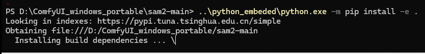

# 20261105
### 1. Windows python
Set and config:    

```
python_embeded\python.exe -m pip config set global.index-url https://pypi.tuna.tsinghua.edu.cn/simple
python_embeded\python.exe -m pip config get global.index-url 
https://pypi.tuna.tsinghua.edu.cn/simple
python_embeded\python.exe -m pip install -e .\sam2-main\
```



