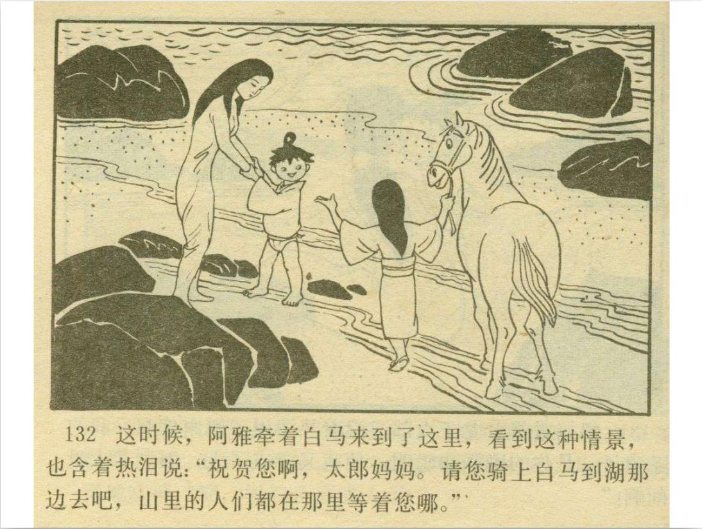
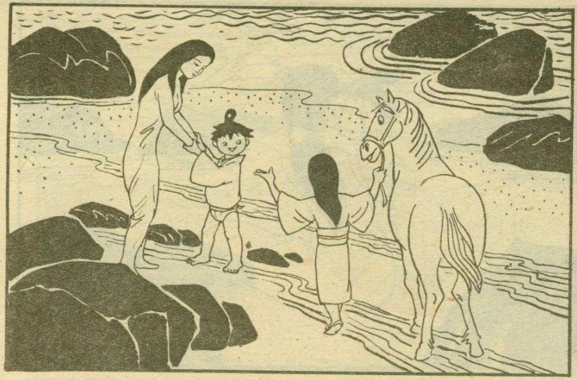
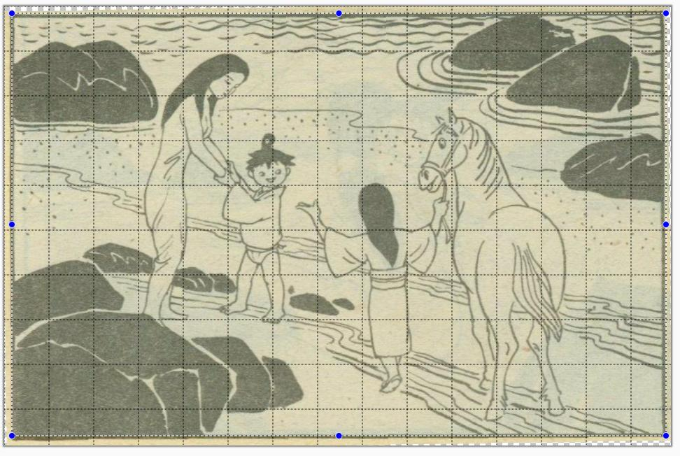
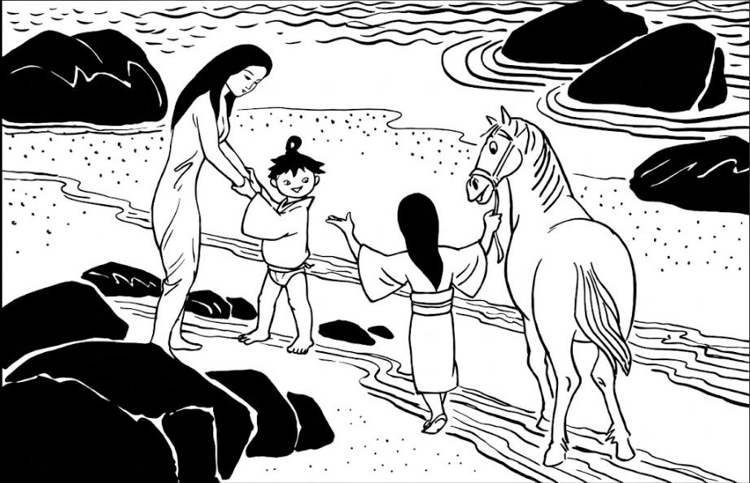
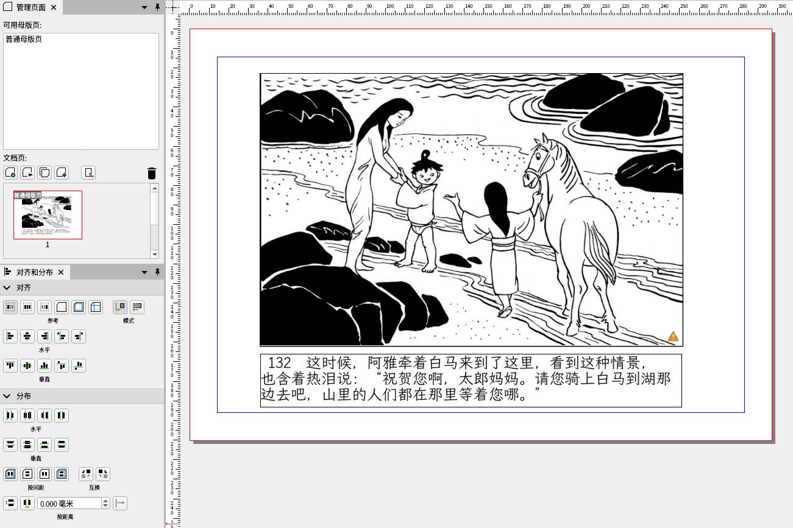
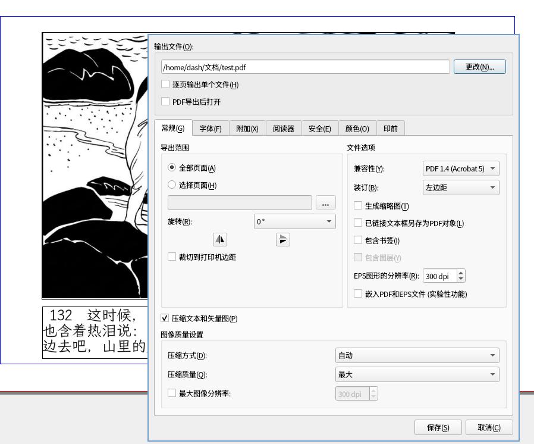
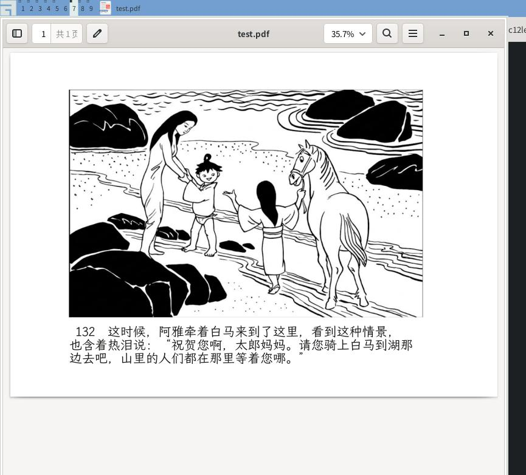

# Guji
### 1. 古籍修复思路
原图片(以135页为例), 原图:    



截取出图形部分:    



在图像编辑软件中，旋转一定角度，使图片的边框保持与网格水平对齐：    



对裁剪后的图片做图像处理，使得它看起来像新的一样。



一个可能的提示词如下:     

```
作为一个 Linux 专家，我需要你的帮助来清理并翻新一张旧的黑白线稿插图。
目标： 将一张陈旧的、有纸张纹理和污点的黑白光栅图像（例如：old_image.jpg）转换为一个干净、清晰、高对比度的纯线稿图像，完全去除陈化效果，看起来像新印制的。

环境： Linux 命令行。
工具偏好： 请使用 ImageMagick 和 Potrace。

具体步骤要求：
请提供一个完整的 bash 脚本或一系列命令行指令，按以下顺序执行：
预处理 (ImageMagick)： 将图像转换为灰度，并使用自适应阈值或二值化（binary threshold）方法清理所有灰色和污点，只保留黑色线条和白色背景。
矢量化 (Potrace)： 将清理后的二值图像矢量化，生成一个干净的 SVG 文件。这一步对于生成清晰、锐利的边缘并彻底去除原始光栅图像的纹理至关重要。
（可选但推荐）转回 PNG (ImageMagick)： 将 SVG 文件转换回一个高分辨率的 PNG 文件，例如 cleaned_image.png，以便在标准图像查看器中查看。
请确保指令中包含所有必要的参数，并解释每一步和每个主要参数的作用。

软件名称	用途	Linux 安装示例 (基于 Debian/Ubuntu)
ImageMagick	用于预处理：清理、增强对比度、二值化、格式转换（PNG 到 PNM, SVG 到 PNG）。	sudo apt update && sudo apt install imagemagick
Potrace	用于核心转换：将光栅位图（如清理后的 PNM 文件）转换为干净的矢量图（SVG）。	sudo apt update && sudo apt install potrace
```

同时，我们使用OCR功能提炼出图片里的文字部分：   

```
 132  这时候，阿雅牵着白马来到了这里，看到这种情景，
也含着热泪说： “祝贺您啊，太郎妈妈。请您骑上白马到湖那
边去吧，山里的人们都在那里等着您哪。”
```

在scribus中，编辑的效果如下：    



保存为PDF：   



在evince中查看的效果如下:    



